<!-- markdownlint-disable-next-line MD041 -->
<p align="center">
  
</p>

<p align="center">
  <a href="https://librarius.zelytra.fr"></a>
  <a href="LICENSE"></a>
  
  
</p>

# Librarius

**A home for every book and manga you own, read, or want.** Librarius keeps your collection,
tracks your reading page by page, follows your series volume by volume and tells you when the
next one comes out. It works on your phone, your tablet and your desktop, in light or dark.

<p align="center">
  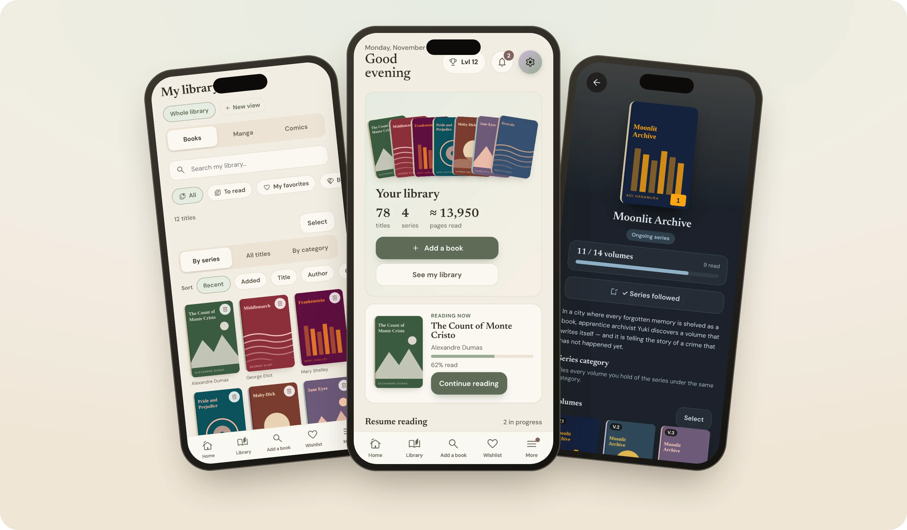
</p>

> **Try it now** at [librarius.zelytra.fr](https://librarius.zelytra.fr). Sign-up is open and
> needs no invitation. It's a staging environment: everything works, but the data may be
> reset before the public release.

## Why you'll like it

- 📚 **Your whole library, at a glance.** Books, manga, comics, graphic novels and
  audiobooks on their own shelves, sorted and filtered your way, with saved views and your
  own categories.
- 📖 **Reading that keeps its place.** Mark a title as to read, reading, read or abandoned,
  log the page you're on, and pick up right where you stopped from the Home screen.
- 🗂️ **Series, volume by volume.** See which volumes you own, which you've read and which are
  **missing**. Follow a series and its **upcoming releases** come to you.
- 🔎 **Add a book in seconds.** Search Open Library, the BnF and AniList at once, or **scan
  the barcode** in a bookshop with your phone's camera.
- 💛 **A wishlist that thinks ahead.** Priorities, prices and a budget, then one tap to move
  a title into your library the day you buy it.
- 📊 **Statistics worth opening.** Yearly goals per medium, pages read, reading pace, your
  favourite authors and genres, the value of your shelves, plus levels and achievements.
- 👥 **Readers, if you want them.** Follow friends, see what they're reading, react to and
  comment on their activity, and share reviews. Your library is private unless you choose
  otherwise.
- 🔁 **Your data stays yours.** Import from Booknode, Babelio, Mangacollec or a CSV file,
  export everything as CSV or JSON at any time, and delete your account and all its data in
  one go.
- 🎨 **Made to feel good.** Nine colour themes including two dark ones, a real desktop layout,
  French and English, and WCAG 2.1 AA accessibility.

## A closer look

<table>
  <tr>
    <td align="center" width="33%">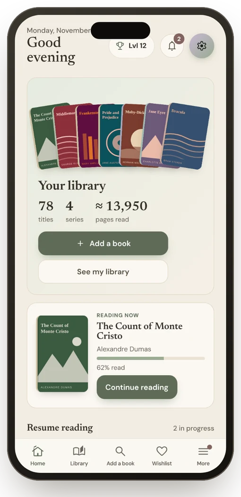<br><sub><b>Home</b>: your shelves, what you're reading, your goals</sub></td>
    <td align="center" width="33%">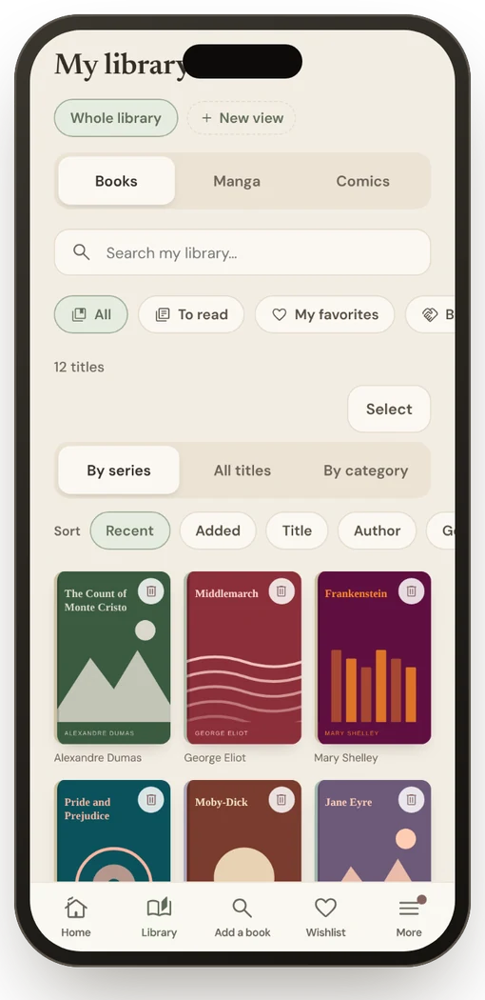<br><sub><b>Library</b>: every medium on its own shelf</sub></td>
    <td align="center" width="33%">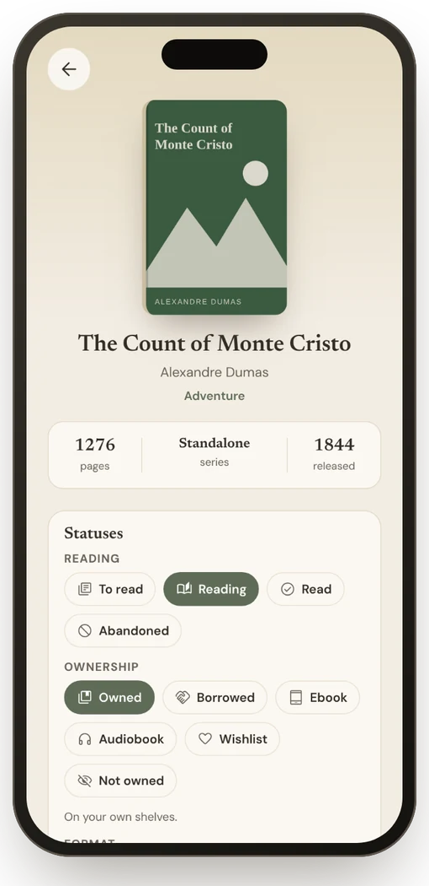<br><sub><b>A book</b>: status, progress, ownership and format</sub></td>
  </tr>
  <tr>
    <td align="center">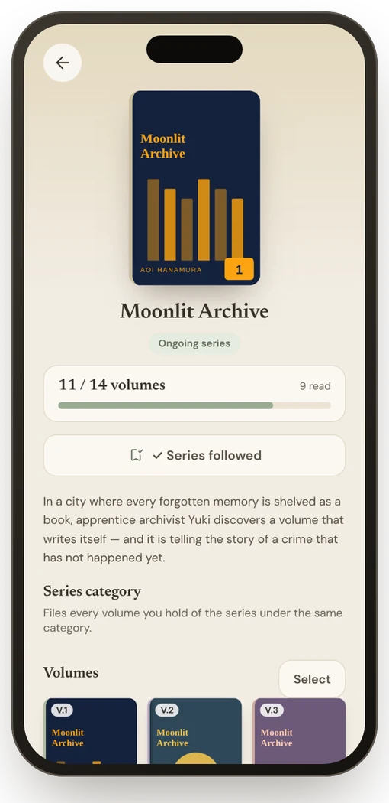<br><sub><b>Series</b>: owned, read, missing and coming next</sub></td>
    <td align="center">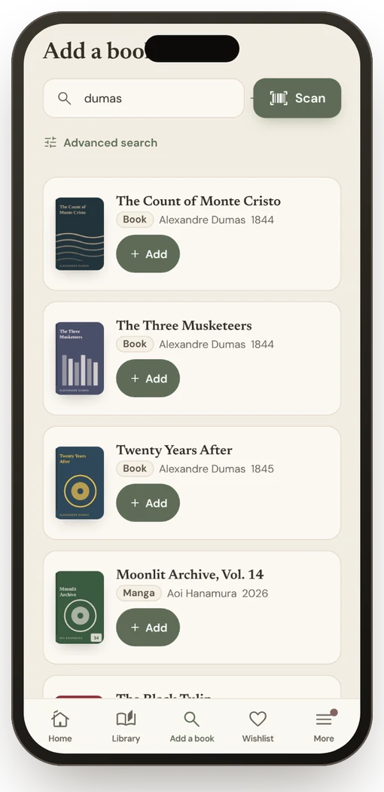<br><sub><b>Add a book</b>: search the catalogs or scan a barcode</sub></td>
    <td align="center">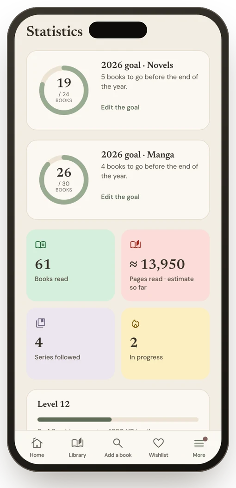<br><sub><b>Statistics</b>: goals, pace and favourites</sub></td>
  </tr>
</table>

### Dark mode, and the rest of the palette

<table>
  <tr>
    <td align="center" width="33%">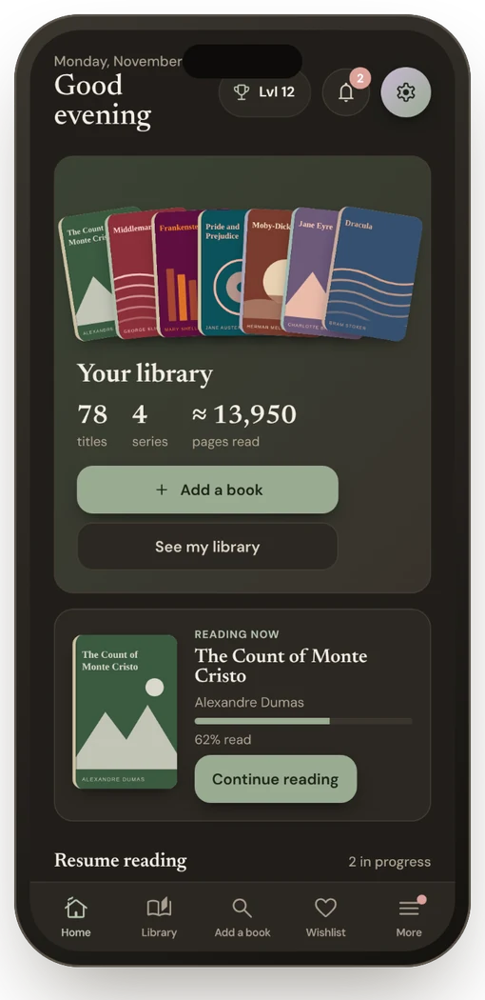</td>
    <td align="center" width="33%">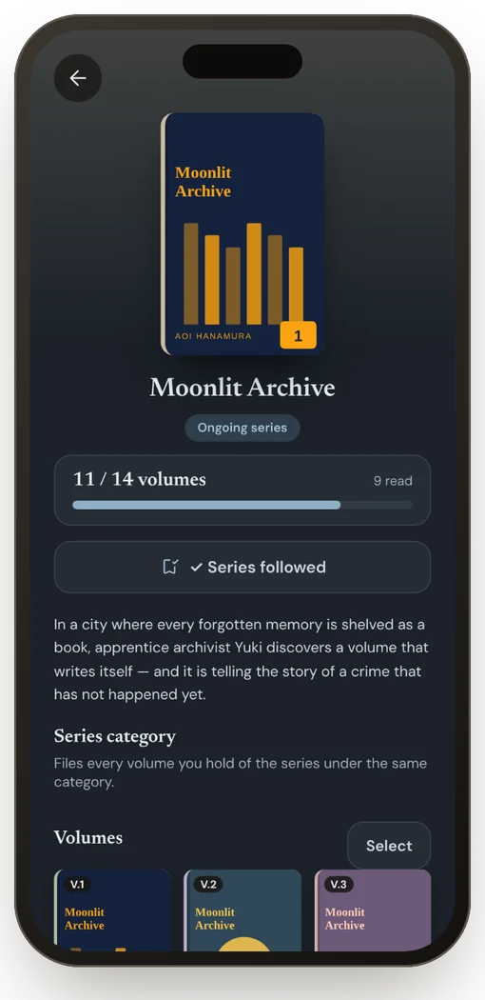</td>
    <td align="center" width="33%">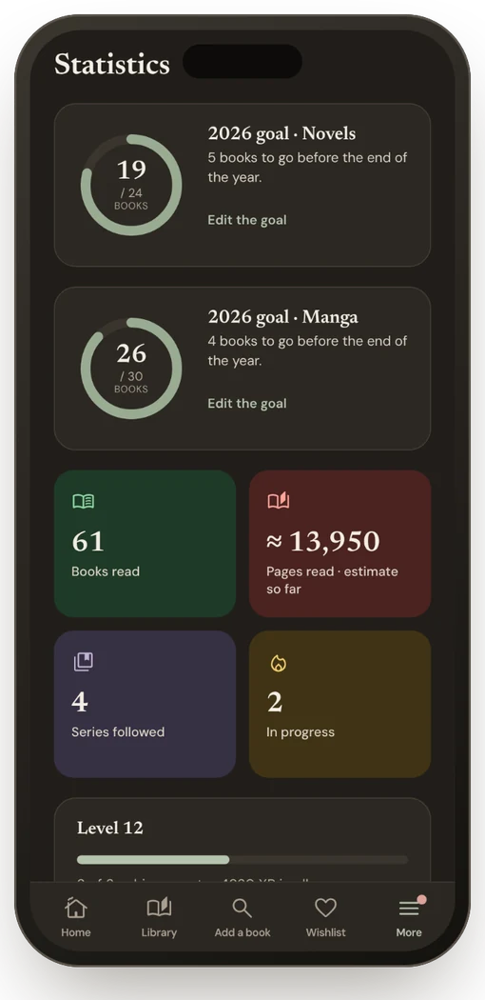</td>
  </tr>
</table>

### On a big screen

<p align="center">
  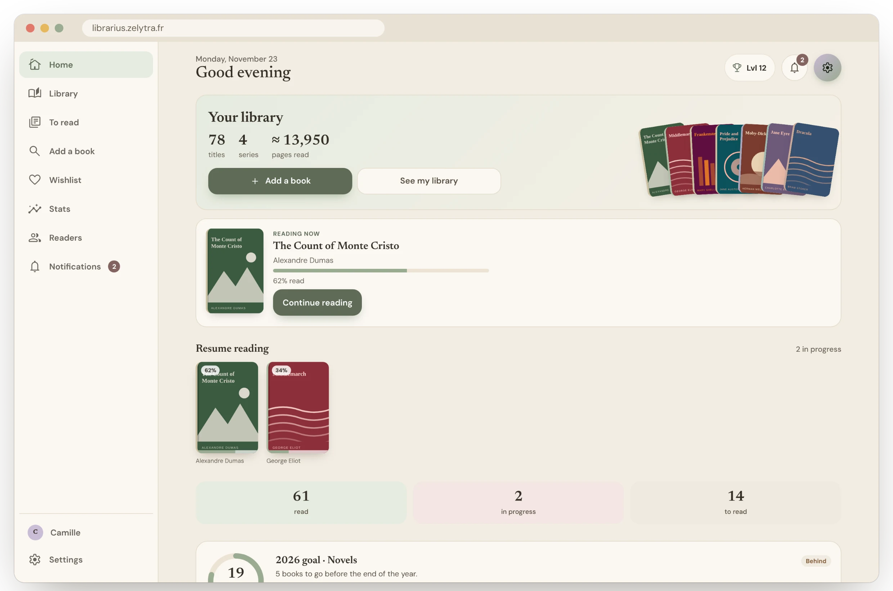
</p>
<p align="center">
  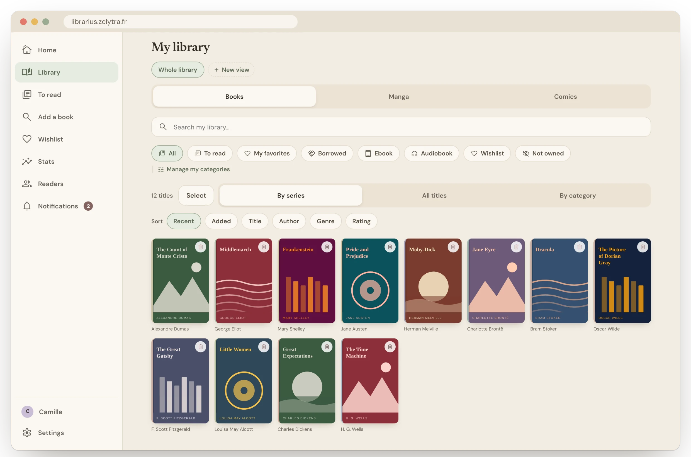
</p>

<sub>Screenshots of the real app with demo data: public-domain classics and invented manga
series, with illustrative covers.</sub>

## Get the app

| Where | How |
|---|---|
| **Any browser** | Open [librarius.zelytra.fr](https://librarius.zelytra.fr) and sign up. |
| **Phone, as an app** | Same address, then *Add to Home Screen*: it installs as a PWA and works offline. |
| **Android and iOS** | Native builds (with barcode scanning and notifications) are on their way to the stores. |
| **Your own server** | Self-host it for personal use: see [Deployment](docs/wiki/Deployment.md). |

---

## For developers

Librarius is a monorepo: a **React PWA**, a **Quarkus API**, **PostgreSQL** and
**Keycloak**, with a Capacitor shell for the mobile apps. New here? Start with the
[developer wiki](docs/wiki/Home.md), then read [CONTRIBUTING](CONTRIBUTING.md).

## Stack

| Layer | Technology |
|---|---|
| Frontend | React + Vite + TypeScript, responsive **PWA** (desktop + mobile) |
| Backend | Java + **Quarkus** (REST, Hibernate Panache, Flyway) |
| Database | PostgreSQL |
| Auth | **Keycloak** (OIDC), end to end |
| Monitoring | Prometheus + Grafana (Micrometer), plus Alertmanager and alerting rules with runbooks |
| Mobile | **Capacitor** shell around the same web build (`apps/mobile`) |
| Monorepo | pnpm workspaces (web, mobile) + Maven (api) |

## Monorepo layout

```text
apps/
  web/        # React + Vite + TS PWA
  api/        # Quarkus API (Maven, mvnw wrapper)
  mobile/     # Capacitor shell (Android/iOS): runs the web build, holds no code of its own
openapi/      # Contract between api and web: schema produced by the api, consumed by orval
packages/     # Shared libraries — empty to date, the workspace glob expects it
e2e/          # Playwright suite: the key journeys against the whole stack
infra/        # docker-compose (dev & prod), Keycloak realm, Prometheus, Grafana, Helm chart
docs/         # ARCHITECTURE.md, DEPLOYMENT.md
.claude/docs/ # Detailed working documentation, for whoever picks up a task next
.github/      # CI/CD workflows
```

## Requirements

- **Node.js 24** + **pnpm 9** (`corepack enable` or `npm i -g pnpm`)
- **JDK 21+**
- **Docker**, to run PostgreSQL, Keycloak, Prometheus and Grafana locally

## Quick start

```bash
# 1. Frontend dependencies
pnpm install

# 2. Infra: postgres + keycloak + prometheus + grafana
pnpm infra:up           # keycloak :8081 · prometheus :9090 · grafana :3000

# 3. Backend (port 8080)
pnpm api:dev            # cd apps/api && ./mvnw quarkus:dev

# 4. Frontend (port 5173, proxies /api → 8080)
pnpm web:dev
```

Open http://localhost:5173. Catalog search (the **Discover** screen) requires a
Keycloak login: use one of the test accounts, **alice / alice** or **bob / bob**. The
Keycloak admin console lives at http://localhost:8081 (admin / admin).

**Monitoring**: the API exposes its Prometheus metrics on `/q/metrics`. Prometheus runs
on http://localhost:9090 and Grafana on http://localhost:3000 (admin / admin), with the
dashboard "Librarius — Vue d'ensemble" provisioned automatically.

## Handy scripts

| Command | Effect |
|---|---|
| `pnpm web:dev` / `web:build` / `web:test` / `web:lint` | Frontend |
| `pnpm api:dev` / `api:test` | Backend (through `mvnw`) |
| `pnpm mobile:build` | Builds the web bundle, then syncs it into the native shell |
| `pnpm infra:up` / `infra:down` | Local Docker stack |
| `pnpm e2e:install` then `pnpm e2e` | End-to-end journeys (starts and stops its own stack) |

## Quality gate

Run before every push — it is also exactly what CI runs:

```bash
pnpm web:lint && pnpm --filter @librarius/web typecheck && pnpm web:test && pnpm web:build
```

```bash
cd apps/api && ./mvnw -B verify
```

The full checklist — OpenAPI client regeneration, bundle size budget, end-to-end suite —
is in [`.claude/docs/CONVENTIONS.md`](.claude/docs/CONVENTIONS.md).

## Contribution & git flow

`main` ← `feature/*`, no `develop` branch: every change is a pull request against `main`,
squash-merged once CI is green — merge commits are refused, and a squashed pull request
title becomes the commit subject, so write it with care. Merging deploys to staging;
production will be deployed by tagging `main`. Everything in this repository is written in
English: code, comments, documentation, commit messages and pull requests alike.

## Documentation

- **[`docs/GUIDE.md`](docs/GUIDE.md)** 🇫🇷 — the **user** guide: the shared catalog versus
  your own library, works and editions and volumes, reading statuses, shelves, import and
  export. The only document here written for the people using the application.
- **[Developer wiki](https://github.com/zelytra/Librarius/wiki)** — start here if you are
  new to the project: architecture, catalog search, data model, running it locally,
  contributing, deployment.
- **[`docs/ARCHITECTURE.md`](docs/ARCHITECTURE.md)** — technical choices and the pull
  request roadmap, kept current as the code changes.
- **[`docs/DEPLOYMENT.md`](docs/DEPLOYMENT.md)** — the full deployment guide: releases,
  secrets, monitoring, backups, rollback.
- **[`.claude/docs/`](.claude/docs/README.md)** — detailed working documentation for
  whoever picks up a task next, human or agent.

## Deployment

Docker images (JVM api + nginx web) are pushed to GHCR by `cd.yml` on every merge into
`main` (tags `latest` and `<sha>`, then deployed to **staging**,
[librarius.zelytra.fr](https://librarius.zelytra.fr)) and by `release.yml` on a
`vX.Y.Z` tag (tags `X.Y.Z`, `X.Y`, `X` and `<sha>`). **Production does not exist yet** — it
opens at the v1.0 milestone. Releases are listed in [`CHANGELOG.md`](CHANGELOG.md); the full
guide, including the rollback procedure, is in
[`docs/DEPLOYMENT.md`](docs/DEPLOYMENT.md).

## Community

- [Contributing](CONTRIBUTING.md): how to report a bug, propose a change and open a pull request.
- [Code of Conduct](CODE_OF_CONDUCT.md): the rules everyone here follows.
- [Security policy](SECURITY.md): how to report a vulnerability privately.
- [Support](SUPPORT.md): where to ask for help.

## License

Librarius is **source-available** under the [PolyForm Noncommercial License 1.0.0](LICENSE).
You may use, study, modify and share it for free for any **non-commercial** purpose:
personal use, study, research, hobby projects, charities and public institutions.
**Commercial use is reserved to the author**; open an issue if you'd like to discuss one.
Contributions are welcome under the terms described in [CONTRIBUTING](CONTRIBUTING.md#license-of-contributions).
